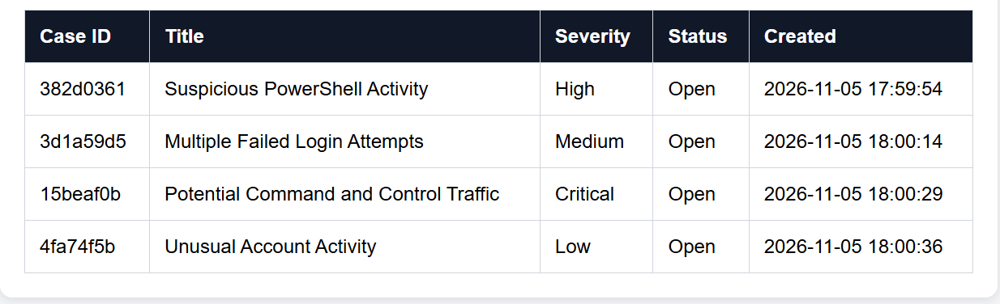
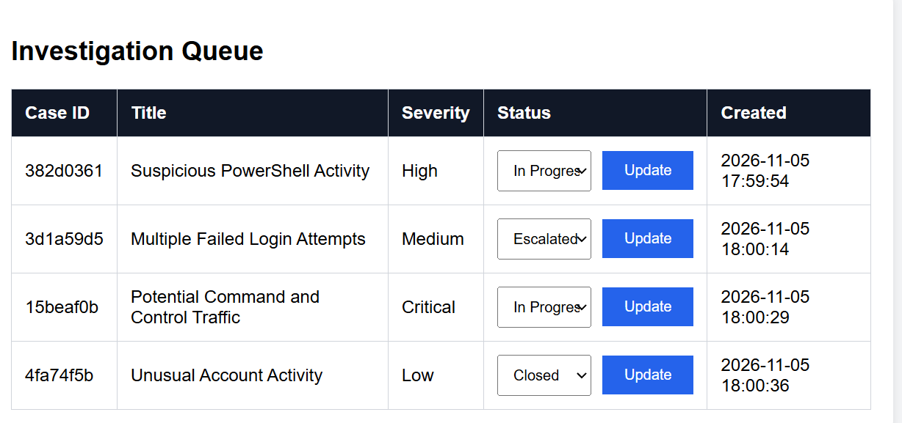
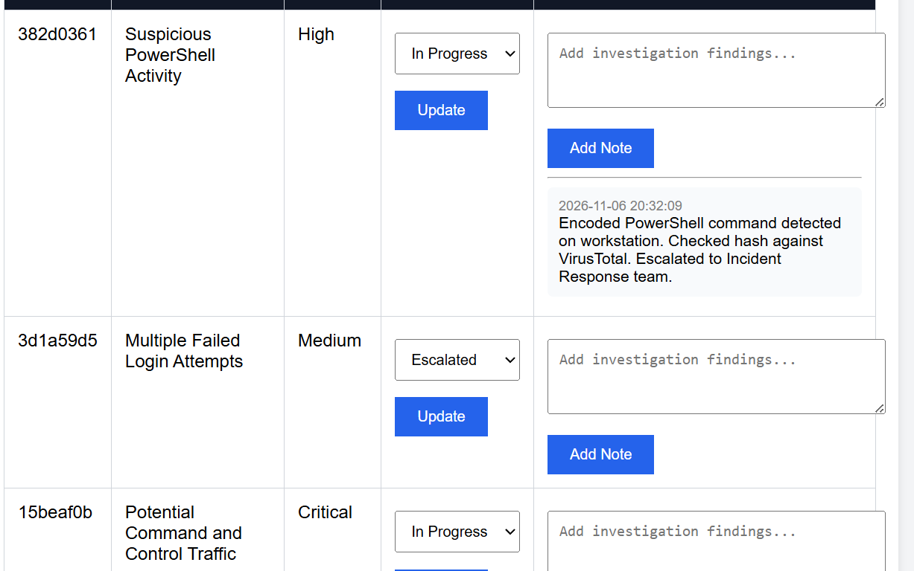
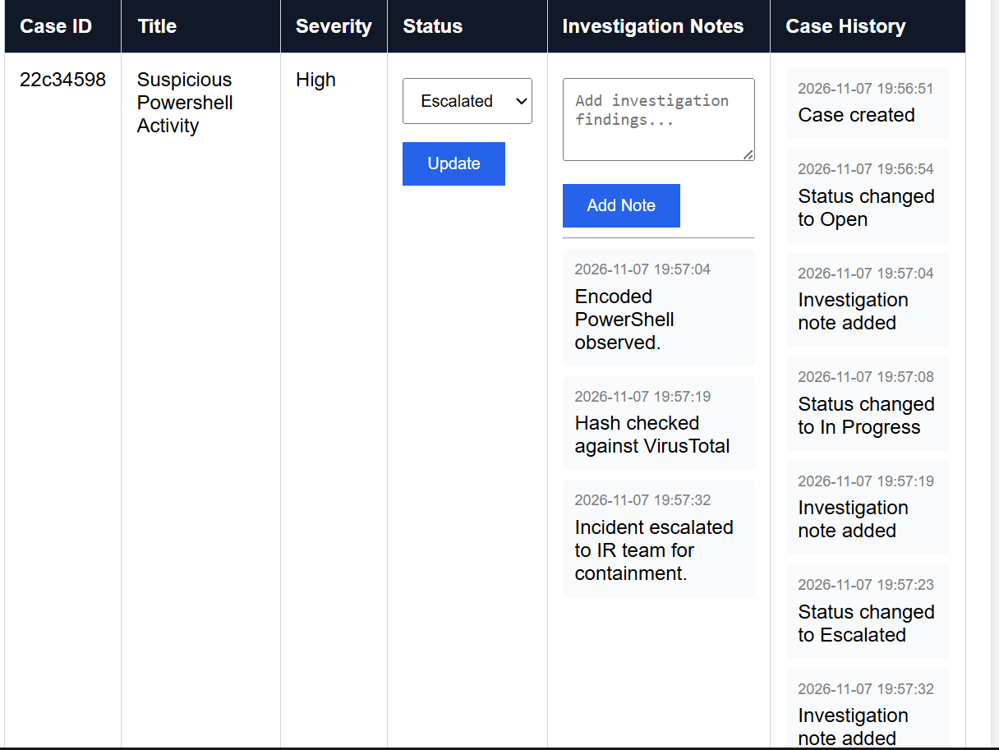
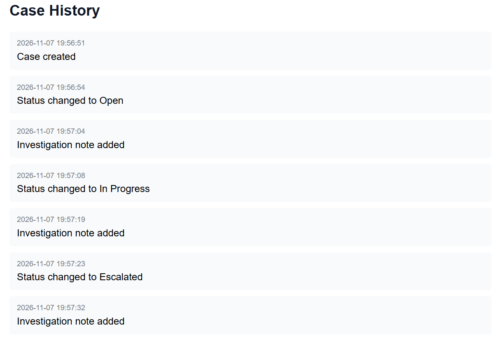
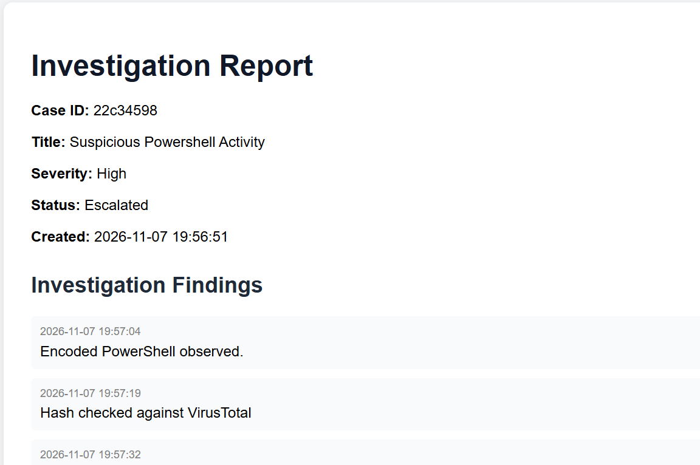
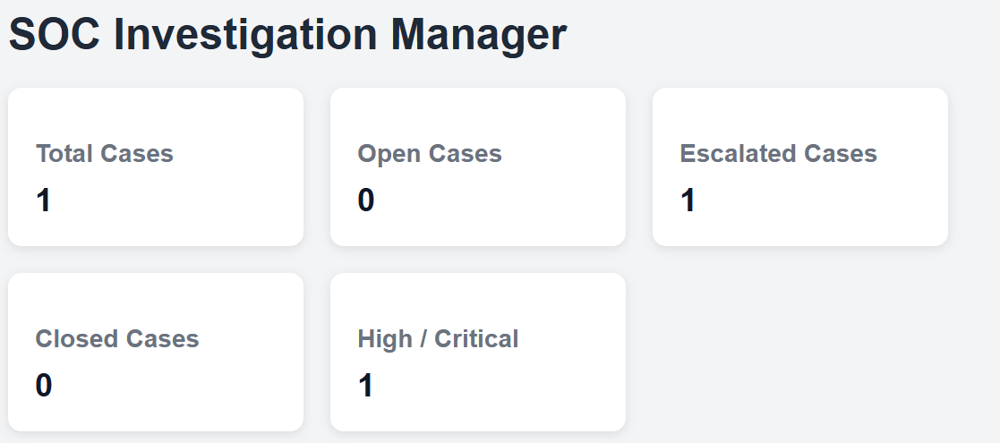

# SOC Investigation Manager

A case management tool for SOC investigations, built with Python and Flask. Analysts can open cases for security alerts, assign them, track their status, escalate them to the right team, record findings, attach indicators of compromise (IOCs), tag MITRE ATT&CK techniques and generate a report. Every action is recorded in an audit trail. Other tools, such as an alert engine, can create cases automatically through a secured API.

## Features

- **Dashboard metrics:** total, open, in progress, escalated, closed and high/critical cases at a glance
- **Case creation:** title, severity (Low, Medium, High, Critical) and an optional assigned analyst
- **Status tracking:** Open → In Progress → Escalated → Closed
- **Escalation workflow:** escalate a case to a team (Tier 2 Analyst, Incident Response, SOC Manager or Threat Intelligence) with a required reason; each escalation records who escalated it, when and why, and shows on the case page and report
- **Analyst assignment:** assign or reassign cases
- **Investigation notes:** timestamped findings added to each case
- **IOCs:** record IPs, domains, URLs and file hashes (MD5, SHA1, SHA256), each validated before saving, with duplicates ignored
- **MITRE ATT&CK tagging:** tag techniques such as `T1059.001`, each linking to its page on the MITRE ATT&CK site
- **Audit trail:** every action (creation, assignment, status changes, escalations, notes, IOCs, techniques) is logged with a timestamp
- **Case view and report:** a full case page and a printable investigation report
- **Automated case creation API:** other tools can create and read cases through a REST API protected by an API key

## Screenshots

### 1. Case creation and dashboard


### 2. Status management


### 3. Investigation notes


### 4. Case history timeline


### 5. Case details view


### 6. Investigation report


### 7. SOC metrics dashboard


## Running it locally

```bash
git clone https://github.com/Maliyka-L/Investigation_Manager.git
cd Investigation_Manager
python -m venv venv
venv\Scripts\activate        # Windows
# source venv/bin/activate   # macOS / Linux
pip install -r requirements.txt
python app.py
```

Then open http://127.0.0.1:5000 in your browser.

To turn on Flask debug mode while developing, set `FLASK_DEBUG=1` first. Debug mode is off by default because Flask's debugger can run code, so it must never be enabled where other people can reach the app.

## API

The API lets other tools, such as an alert engine, create cases automatically. It runs locally as part of the app, so it's free to use.

It's switched off unless you set an API key. The key is one you make up yourself, like a password; nobody issues it. Set it before starting the app:

```bash
set IM_API_KEY=choose-a-long-random-key        # Windows (Command Prompt)
# $env:IM_API_KEY="choose-a-long-random-key"   # Windows (PowerShell)
# export IM_API_KEY=choose-a-long-random-key   # macOS / Linux
python app.py
```

Every request must include the key in an `X-API-Key` header. Never commit your key to GitHub.

### Create a case: `POST /api/cases`

```json
{
    "title": "Brute force detected",
    "severity": "High",
    "source": "Alert Engine",
    "description": "25 failed logins in 2 minutes",
    "iocs": [{"type": "IP", "value": "203.0.113.5"}],
    "mitre": ["T1110"]
}
```

Only `title` and `severity` are required. The description becomes the first investigation note. Returns `201` with the new `case_id`, plus any IOCs or techniques that failed validation:

```json
{"case_id": "a1b2c3d4", "rejected_iocs": [], "rejected_mitre": []}
```

Example from Python:

```python
import os
import requests

response = requests.post(
    "http://127.0.0.1:5000/api/cases",
    headers={"X-API-Key": os.environ["IM_API_KEY"]},
    json={"title": "Brute force detected", "severity": "High", "source": "Alert Engine"}
)
print(response.status_code, response.json())
```

### Get a case: `GET /api/cases/<case_id>`

Returns the full case as JSON.

### Responses

| Code | Meaning |
|---|---|
| 201 | Case created |
| 200 | Case returned |
| 400 | Invalid data (e.g. bad severity or missing title) |
| 401 | Missing or wrong API key |
| 404 | Case not found |
| 503 | API switched off (no `IM_API_KEY` set) |

## How it works

- Cases are stored in `data/investigations.json`
- All input is validated: severity, status, IOC type and escalation team must be allowed values; IPs are checked with Python's `ipaddress` module; domains, hashes and MITRE IDs are checked with patterns; and titles, notes and names have length limits
- Jinja2 auto-escaping stops user-entered text from being run as HTML or JavaScript (XSS)
- Escalating always needs a team and a reason, so it has its own form; closed cases can't be escalated
- Missing cases return a 404 rather than failing silently
- The API key is read from an environment variable, so no secrets are stored in the code

## Project structure

```
Investigation_Manager/
├── app.py
├── requirements.txt
├── data/
│   └── investigations.json   # sample case
├── screenshots/               # images used in this README
└── templates/
    ├── index.html             # dashboard
    ├── case.html              # case details, escalation, IOCs, MITRE, assignment
    └── report.html            # investigation report
```

## Security notes

This is a local, single-user portfolio project. Before using it anywhere shared, it would need:

- User login and role-based access
- CSRF protection on web forms (for example Flask-WTF)
- A database instead of a JSON file, to handle several users safely
- HTTPS for the API

## Future improvements

- Search and filtering on the dashboard
- Exporting reports to PDF
