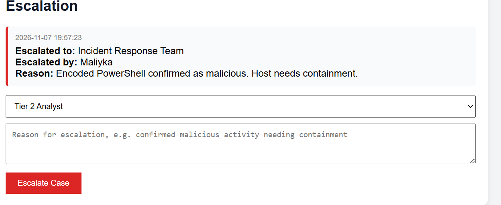

# SOC Investigation Manager

A SOC investigation and case management platform built with Python and Flask.

The application allows analysts to create and manage security investigations, assign ownership, track case status, escalate incidents, record findings, attach indicators of compromise (IOCs), map MITRE ATT&CK techniques, generate investigation reports and maintain a complete audit trail of analyst activity.

The platform also includes a REST API endpoint that enables external security tools, alert engines and detection systems to automatically create investigation cases.

## Features

- **Dashboard metrics:** total, open, in progress, escalated, closed and high/critical cases at a glance
- **Case creation:** title, severity (Low, Medium, High, Critical) and an optional assigned analyst
- **Status tracking:** Open → In Progress → Escalated → Closed
- **Escalation workflow:** escalate a case to a team (Tier 2 Analyst, Incident Response Team, SOC Manager or Threat Intelligence Team) with a required reason; each escalation records who escalated it, when and why
- **Analyst assignment:** assign or reassign investigations to analysts
- **Investigation notes:** timestamped findings added to each case
- **IOCs:** record IP addresses, domains, URLs and file hashes (MD5, SHA1, SHA256), each validated before saving, with duplicates automatically ignored
- **MITRE ATT&CK tagging:** associate investigations with MITRE ATT&CK techniques such as `T1059.001`
- **Case management:** ownership tracking, escalation history, IOC management and MITRE ATT&CK mapping throughout the investigation lifecycle
- **REST API integration:** external security tools can automatically create cases through the `/api/create_case` endpoint
- **Audit trail:** every action (creation, assignment, status changes, escalations, notes, IOCs and MITRE techniques) is recorded with a timestamp
- **Case view and reporting:** detailed investigation pages and printable investigation reports

## SOC Workflow

```text
Security Alert
       ↓
Case Creation
       ↓
Analyst Assignment
       ↓
Investigation Notes
       ↓
IOC Collection
       ↓
MITRE ATT&CK Mapping
       ↓
Escalation (if required)
       ↓
Report Generation
       ↓
Case Closure
```

## Screenshots

### 1. Case creation and dashboard


### 2. Status management


### 3. Investigation notes


### 4. Case history timeline


### 5. Case details view


### 6. Investigation report


### 7. SOC metrics dashboard


### 8. Case management features



## Running it locally

```bash
git clone https://github.com/Maliyka-L/Investigation_Manager.git
cd Investigation_Manager

python -m venv venv

venv\Scripts\activate
# source venv/bin/activate

pip install -r requirements.txt

python app.py
```

Then open:

```text
http://127.0.0.1:5000
```

in your browser.

To enable Flask debug mode while developing, set:

```bash
set FLASK_DEBUG=1
```

before running the application.

Debug mode is disabled by default because Flask's debugger can execute code and should never be enabled where other users can access the application.

## How it works

- Cases are stored in `data/investigations.json`
- Cases can be created manually through the web interface or automatically through the REST API
- The `/api/create_case` endpoint allows external tools to generate investigation cases automatically
- All user input is validated before being processed or saved
- Severity, status, IOC types and escalation teams must match approved values
- IP addresses are validated using Python's `ipaddress` module
- Domains, hashes and MITRE ATT&CK technique IDs are validated using regular expressions
- Length limits are enforced on titles, notes, analyst names and escalation reasons
- Jinja2 auto-escaping helps protect against cross-site scripting (XSS)
- Escalations require both a target team and a reason
- Closed investigations cannot be escalated
- Missing cases return a 404 response instead of failing silently
- Every important action is recorded in a case audit trail

## Technologies Used

- Python
- Flask
- Jinja2
- HTML
- CSS
- JSON
- REST APIs
- MITRE ATT&CK Framework
- IOC Validation
- Security Investigation Workflows

## Project Structure

```text
Investigation_Manager/
├── app.py
├── requirements.txt
├── data/
│   └── investigations.json
├── screenshots/
│   ├── commit1_case_creation_dashboard.png
│   ├── commit2_status_management.png
│   ├── commit3_investigation_notes.png
│   ├── commit4_case_history_timeline.png
│   ├── commit5_case_details_view.png
│   ├── commit6_investigation_report.png
│   ├── commit7_soc_metrics_dashboard.png
│   ├── commit8_case_management.png
│   └── commit9_automated_case_creation_api.png
└── templates/
    ├── index.html
    ├── case.html
    └── report.html
```

## Security Notes

This is a local, single-user portfolio project.

Before using it in a shared or production environment, it would require:

- User authentication
- Role-based access control
- CSRF protection for forms
- Database-backed storage instead of JSON files
- Secure session management
- Logging and monitoring controls

## Future Improvements

- Advanced dashboard visualisations using Chart.js
- Search and filtering across investigations
- PDF export for investigation reports
- Analyst workload tracking
- Case correlation and relationship mapping
- Threat intelligence enrichment from external feeds
- Integration with log analysis and alert management systems
- Full ThreatHunter SIEM integration